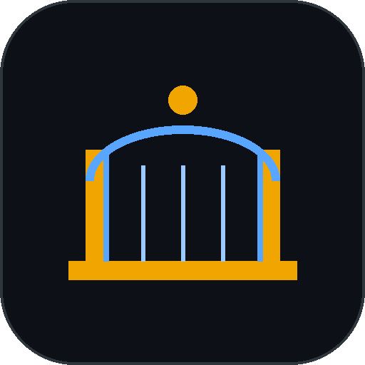
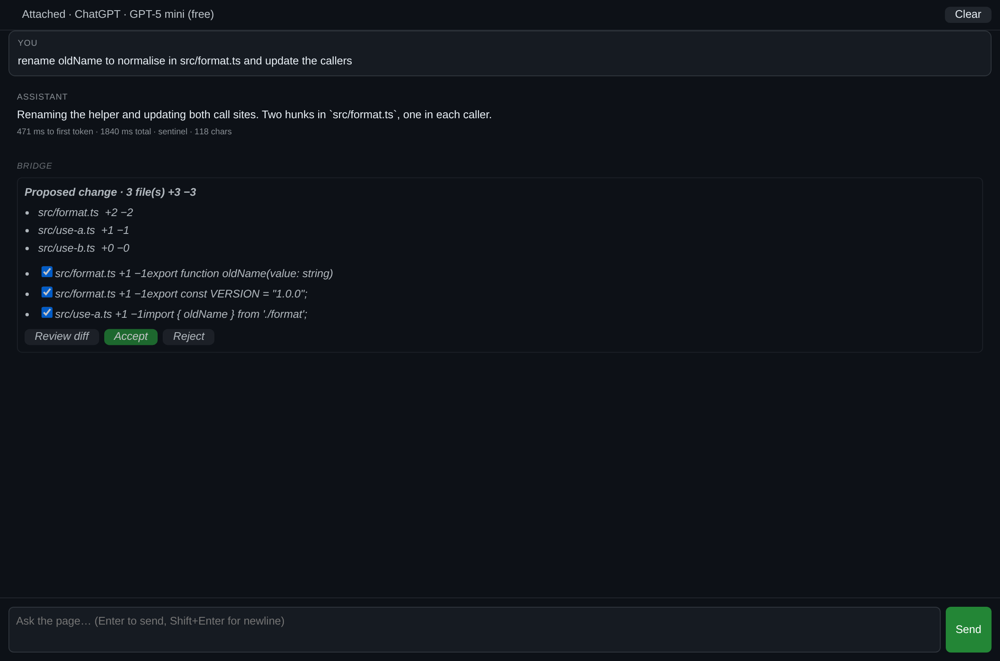
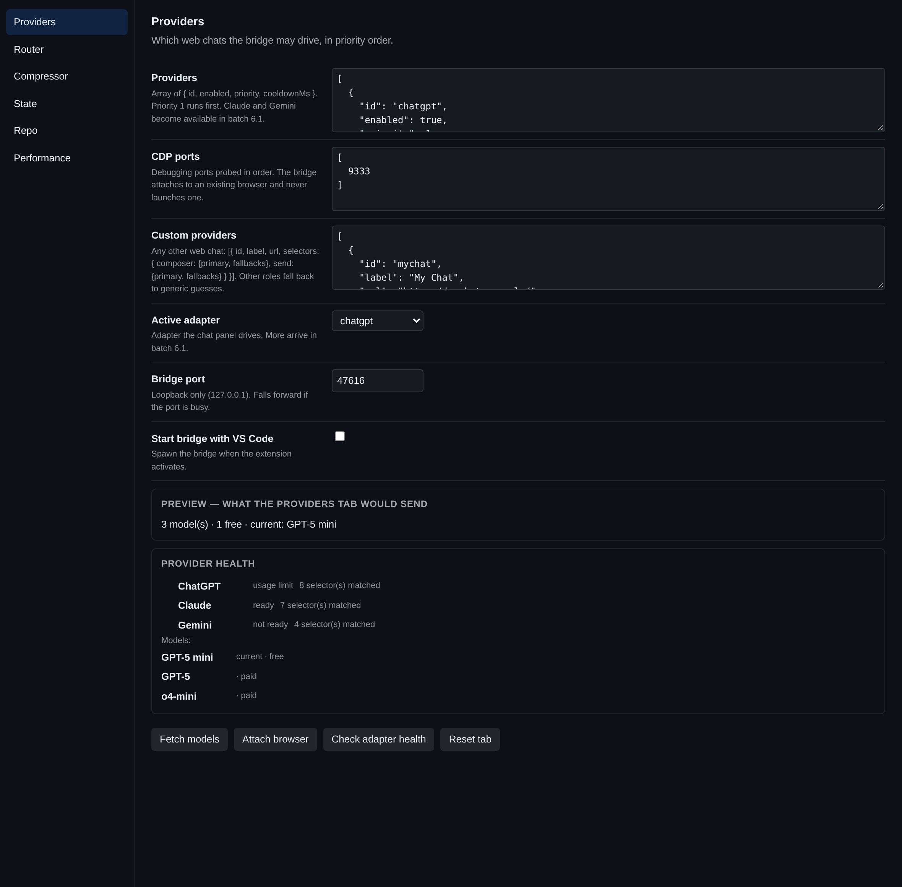
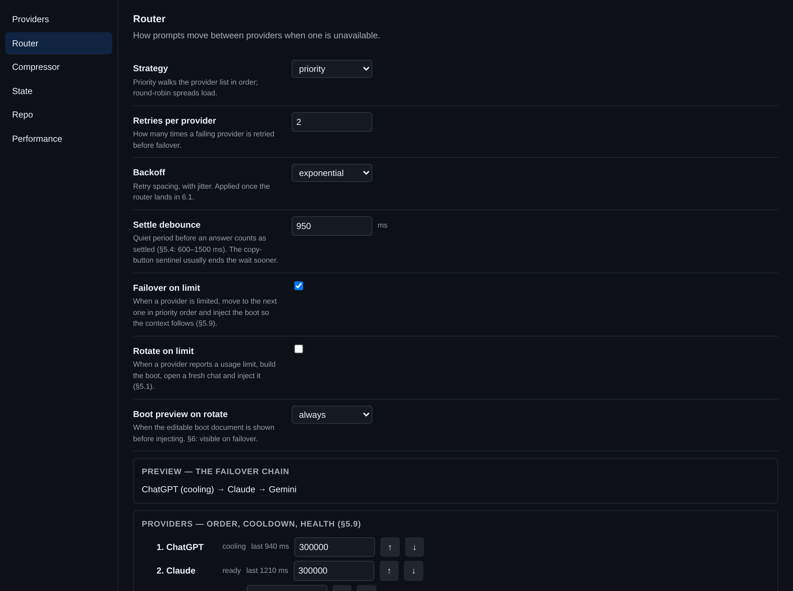

<div align="center">



# AI Bridge

[](LICENSE)

**Your browser's AI, inside VS Code. No API key, no second subscription.**

<a href="LICENSE"></a>
<a href="extension/package.json"></a>
<a href="#what-is-actually-proven"></a>
<a href="https://code.visualstudio.com"></a>
<a href="https://nodejs.org"></a>
<a href="docs/badges/providers.svg"></a>
<a href="#what-is-actually-proven"></a>
</div>

---

You are already signed in to ChatGPT in Chrome. You already pay for it. AI Bridge attaches to
that tab over the Chrome DevTools Protocol and drives it from inside VS Code — reading answers,
writing edits into your workspace, and keeping a project state that survives a new chat.

It never launches a browser. It never asks for an API key. It uses the tab you opened.

<br />

<div align="center">
  
  <br />
  <sub><b>Chat panel</b> — streamed answers, and edits you accept hunk by hunk</sub>
</div>

<br />

## Why it exists

- **No API keys.** Nothing to paste, nothing to leak, nothing to bill.
- **Your subscription, your session.** It drives the page you already use, with the model you already chose.
- **Edits you can refuse.** Every change arrives as a proposal with a diff; untick what you don't want, accept the rest in one undo step.
- **It survives the limit.** When ChatGPT says *"you've reached your limit"*, the context moves to Claude or Gemini and the conversation continues.

<br />

<table>
<tr>
<td width="50%"><br /><sub><b>Providers</b> — health dots, the model list, and any provider you configure yourself</sub></td>
<td width="50%"><br /><sub><b>Router</b> — priority, cooldowns, failover, and a preview of the chain it would try</sub></td>
</tr>
</table>

<br />

## Install

**From a build:**

```bash
code --install-extension ai-bridge-0.20.4.vsix
```

**From source:**

```bash
git clone https://github.com/drsamonline/ai-bridge.git
cd ai-bridge
npm install && npm run build && npm run package
code --install-extension ai-bridge-0.20.4.vsix
```

<br />

## Five steps to first use

1. **Open your browser with the debug port on** — close it first, then:
   `chrome --remote-debugging-port=9222`
2. **Sign in to ChatGPT** in that window, normally.
3. **Attach:** `Ctrl+Shift+P` → *AI Bridge: Attach Browser*.
4. **Check the dot:** `Ctrl+Shift+P` → *AI Bridge: Adapter Health*. Green means the selectors matched.
5. **Ask something:** `Ctrl+Alt+A` opens the chat panel. Try *"rename oldName to normalise in src/format.ts"*.

If a dot is red, the site changed its page — press **AI Bridge: Export Breakage Report** and send
that file. It contains no conversation text.

<br />

## How it works

```
┌──────────────┐   loopback WS    ┌──────────────┐   CDP    ┌────────────────────┐
│  VS Code     │◄────────────────►│   Bridge     │◄────────►│  your browser tab  │
│  extension   │  127.0.0.1 only  │  (Node)      │ 9222     │  ChatGPT / Claude  │
└──────┬───────┘                  └──────┬───────┘          └────────────────────┘
       │                                 │
   edits, state,                   adapters, router,
   settings, panel                 RAM watchdog
```

- The **bridge** is a separate Node process on loopback. It holds the CDP connection and the adapters.
- The **extension** owns everything that touches your workspace: files, diffs, state, settings.
- **Adapters** are selector maps — ChatGPT, Claude, Gemini, or one you add in settings.
- A **router** picks the provider, honours cooldowns, and fails over carrying only what changed.

<br />

## What it does about tokens

Measured, not claimed (`docs/compression-bench.md`):

| input | tokens | saved |
|---|---|---|
| polite one-liner | 34 → 21 | ⇣38% |
| terse one-liner | 8 → 8 | ⇣0% |
| verbose spec paragraph | 113 → 80 | ⇣29% |
| pasted stack trace | 83 → 71 | ⇣14% |
| code request | 68 → 59 | ⇣13% |
| boot prompt | 975 → 974 | ⇣0% |
| repo bundle | 588 → 370 | ⇣37% |

Compression helps on verbose prose and repo context, and does nothing for terse prompts. The bigger
saving is **not sending context that isn't needed**: repo context is attached only when the question
names a file, a symbol or a code term, which avoids a 500–900 token bundle on chatty prompts.

<br />

## Features

| | |
|---|---|
| **Three providers, plus your own** | ChatGPT, Claude, Gemini out of the box; any other web chat via a selector map in settings |
| **Streaming panel** | Virtual-scrolled, first token measured (~471 ms in testing) |
| **Reviewable edits** | Diff card with **per-hunk** accept/reject, one `WorkspaceEdit`, sha-verified, drift-refusing |
| **Project state** | Gzipped, encrypted, snapshotted; a ≤4k boot prompt restores DOING/TODO in a fresh chat |
| **Locked decisions** | "Never do X" is held even in auto mode, with an explicit override flow |
| **Compression** | T0 always (protected spans, glossary), T1 opt-in local model, T2 opt-in provider-side |
| **Session rotation** | On a usage limit: boot → new page → inject, with an editable preview first |
| **Router** | Priority, per-provider cooldowns, exponential backoff + jitter, pre-warm at 80%, free-model preference |
| **RAM watchdog** | 3 s poll, 80% evict + GC, 100% block; low-end mode for 8 GB machines |
| **Settings** | Six tabs, every field, inline validation, a live preview on each tab |
| **Keyboard first** | `Ctrl+Alt+A` chat · `Ctrl+Alt+,` settings · `Ctrl+Alt+R` rotate · `Ctrl+Alt+S` state · `Ctrl+Alt+C` compression |

<br />

## Free-tier API endpoints

Besides the three web chats, the bridge can talk to any endpoint that speaks
`POST {baseUrl}/chat/completions` — OpenRouter's free pool, Groq, Google AI
Studio, Cerebras, GitHub Models, or a local Ollama. These need no browser and no
selectors, so they cannot break when a site changes its page.

- **Model discovery** from `GET {baseUrl}/models`, or a pinned list when the
  catalogue is hundreds of models long.
- **Structural tool calls** where the endpoint supports them; the prompt protocol
  where it does not, scrubbed out of the answer either way.
- **Real usage numbers.** These endpoints report prompt and completion tokens, so
  a remaining count is measured rather than guessed.
- **Keys stay off disk.** They live in memory for the life of the bridge, or in
  `AI_BRIDGE_API_KEY_<ID>`.

Configured over the control plane (`ctl.api.providers.set`); the batch records,
including what was taken from where, are in [`docs/batch8/`](docs/batch8/). Two
suites cover it: `npm run test:api` (32 checks) and `npm run test:tools`
(34 checks).

## What is actually proven

This is an experimental project and it would be dishonest to imply otherwise.

**Proven** — 600 checks across 20 suites, run on every push:

- The bridge, the CDP controller, the watchdog, the router and the state layer.
- All three adapters and a fourth custom one, driven end to end **against fixtures**.
- Per-hunk edits, the locked-decision guard, drift refusal, one-undo applies.
- The boot prompt staying under 4k with every delta present across five failovers.
- A deliberately broken fixture failing the contract suite — the suite detects breakage.
- The breakage report containing no chat content, checked against known fragments.

**Not proven** — and you should know before relying on it:

- **Live selectors.** No adapter has run against the real ChatGPT, Claude or Gemini. Fixtures only.
- **The one-hour memory soak.** Three minutes passes flat; an hour needs real hardware.
- **T1 and T2 quality.** Built, guarded, tested for safety — never run against a real model.
- **Windows.** The code paths exist; only Linux has been exercised.

<br />

## Privacy

- The bridge listens on `127.0.0.1` only, with a token in `~/.ai-bridge/lock.json` (`0600`).
- No telemetry, no analytics, no phone-home. Nothing leaves your machine except the prompts you send to the site you are signed in to.
- State is encrypted at rest by default and redacted before it is written.
- The breakage report is built from an allow-list: host only (no paths, no conversation ids), selectors tried, and tag/attribute **names**. A guard refuses to write it if any chat text appears.

<br />

## Development

```bash
npm install
npm run build          # tsc across shared, bridge, extension
npm run test:all       # 626 checks, 21 suites
npm run test:bench     # token-savings report
npm run soak           # idle memory soak
npm run package        # bundles and builds the .vsix
```

## Releasing

Releases are automatic and version-gated — pushing code alone publishes nothing.

```bash
npm run version:bump patch   # or minor / major, or an explicit 1.2.3
git commit -am "release" && git push
```

Every push to `main` publishes **two** things:

| release | when | what |
|---|---|---|
| **Latest build** (pre-release) | every push | a fresh `.vsix` from that commit, replaced each time |
| **vX.Y.Z** (latest) | only when the version changes | the tagged, tested release |

So there is always a downloadable `.vsix`, and version numbers stay meaningful.

`docs/` deploys to GitHub Pages on any change to the landing page.

Layout: `shared/` contracts and wire types · `bridge/` the CDP process, adapters, router ·
`extension/` the VS Code side · `test/` fixtures and suites · `docs/` evidence and the landing page.

<br />

## Licence

[PolyForm Noncommercial 1.0.0](LICENSE) — free for personal, research, educational, charitable and
government use; commercial use requires a separate licence from the author.

PolyForm ships several variants (Noncommercial, Small Business, Perimeter, Internal Use Only). This
project uses **Noncommercial**; if you intended another, it is a one-file change.

<div align="center">
<sub>Built by Dr Sohil Momin · Not affiliated with OpenAI, Anthropic or Google</sub>
</div>
