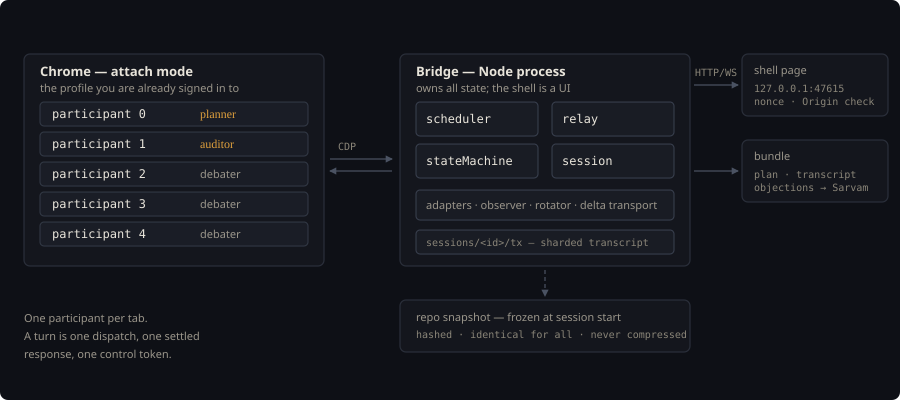

<div align="center">


# AI Bridge Debate

[](../../LICENSE)
[](#what-is-proven-and-what-is-not)
[](SPEC-v6.md)

**Five AI web chats argue a plan to consensus. You get the versioned plan, the objections, and the transcript.**

<a href="SPEC-v6.md"></a>
<a href="#what-is-proven-and-what-is-not"></a>
<a href="runtime-split-map.md"></a>
<a href="#what-is-proven-and-what-is-not"></a>
<a href="https://github.com/drsamonline/ai-bridge"></a>
<a href="https://nodejs.org"></a>
<a href="../../LICENSE"></a>

</div>

---

A single model reviewing its own plan agrees with itself. Ask it to find what is wrong with the
thing it just wrote and it will find something small, fix it, and stop. The disagreement that
would have caught the real mistake never happens, because there is nobody in the room who did not
write the plan.

This engine puts five participants in five browser tabs you are already signed in to — a
**planner**, an **auditor** and up to three **debaters** — and runs them through a deterministic
token protocol until they agree a plan, or until you decide for them. Every plan revision is a
hashed file. Every objection carries a round index and a resolution. The bundle you hand to a
builder is the transcript, not a summary of it.

> [!IMPORTANT]
> **Pre-alpha.** The specification is agreed and the first refactor has landed. No session can run
> yet. What works is the engine underneath: CDP attachment, five provider adapters, response
> settling, repo reading — inherited from [AI Bridge](https://github.com/drsamonline/ai-bridge) and
> green across 34 of 35 suites.

<br />

<div align="center">
  
  <br />
  <sub><b>Shape of it</b> — the bridge is the engine, the shell is a page it serves, and the snapshot is frozen at session start</sub>
</div>

<br />

## Why it exists

- **The roles are separate.** The planner proposes; the auditor checks the proposal against the
  code with a different context window. They cannot quietly converge.
- **The argument is the artifact.** `plan-vN.md` is hashed per revision. `objections-resolved.md`
  is generated from the token stream, not parsed out of prose. A plan you cannot audit is a plan
  you cannot hand to a builder.
- **It stops on a rule.** Consensus requires every active participant to emit `[[CONSENSUS]]` in
  the same round. One dissenter ends the session in your queue rather than being averaged away.
- **The roster is honest about its limits.** Five participants, two of them required, and a round
  budget of seven. When it runs out, a reserved planner turn makes sure the plan you ship includes
  what the last debater said.

## How a session runs

| Participant | Job | Turns with |
|---|---|---|
| **Planner** (1, required) | Revises the plan | Full plan + context + 15 KB snapshot slice |
| **Auditor** (1, required) | Audits the plan against the repo snapshot | Full plan + 30 KB slice, 2× the planner's |
| **Debater** (0–3) | Critiques the plan's reasoning | Plan + context, no snapshot |

One participant per tab, leased for the session and exempt from idle-tab eviction. A turn is one
dispatch, one settled response, one control token. The roster is fixed at session start and mutable
only between rounds.

### The protocol

Six tokens, one per message, last non-whitespace line, outside any fenced block:

| Token | Meaning |
|---|---|
| `[[READY]]` | Handshake and reattach only |
| `[[REPLY]]` | An ordinary turn |
| `[[ASK_USER: q \| opts \| default]]` | Halt and ask. Immediate |
| `[[ESCALATE: one sentence]]` | Extends the round budget by one, capped at three a session |
| `[[OBJECTION: text \| severity]]` | Auditor only. Enters the ledger with its round index |
| `[[CONSENSUS]]` | Counts only if every active participant emits it in the same round |

Parsing is keyed to the response observer, not to a timeout:

```text
settle  →  copy-sentinel or stop-button gone   →  trust the token
        →  debounce (text stopped changing)    →  retry once, then degrade the participant
        →  timeout                             →  STREAM_TIMEOUT
```

The distinction matters: a debounce settle fires while a model is thinking, which is exactly when
a half-written token line is sitting at the end of the buffer.

## What is proven, and what is not

The inherited engine is tested. Everything specific to the debate is specified, reviewed across six
drafts, and unbuilt. The gap between those two sentences is the whole status of this project.

| Claim | State |
|---|---|
| CDP attach, owned tabs, detach without killing the browser | **Proven** — 39 checks |
| Response settling by copy-sentinel, stop-button, debounce | **Proven** — fixtures only |
| Provider adapters against ChatGPT, Claude, Gemini | **Unverified** — fixtures, never live sites |
| Fastpath replay without typing | **Inert** — no provider template exists |
| Round scheduler, state machine, relay, session registry | **Specified** — mapped to line numbers, not written |
| Repo snapshot ranker with per-file token accounting | **Specified** — today `relevance.ts` is a yes/no gate |
| Served-shell nonce and Origin/Host validation | **Specified** — required before the shell ships |
| Two participants sharing one provider account | **Open** — the spec has no account dimension |

The two things that actually gate a first session are neither of the above: live selector validation
against the three web chats, and one fastpath provider template. Neither can be closed by reading a
document.

## Built on AI Bridge

Not a rewrite. The hard part — driving a signed-in browser tab and knowing when it has finished
answering — already exists.

<table>
<tr><td valign="top" width="50%">

**Reused as-is**

- `cdp/controller.ts` — attach, owned tabs, recycle, GC
- `adapters/*` — five providers, one frozen contract
- `adapters/observer.ts` — the settle signal the token parse depends on
- `adapters/signin.ts` — login detection at zero request cost
- `fastpath/*` — template replay, when a template exists
- `repo/reader.ts` — the snapshot provider

</td><td valign="top" width="50%">

**Written for the debate**

- `runtime/scheduler.ts` — who speaks, when a round ends
- `runtime/stateMachine.ts` — fourteen states, per-participant sub-states
- `runtime/relay.ts` — payload assembly, dispatch, token parse
- `runtime/session.ts` — registry, leases, tiers, handoff
- `rotation/rotator.ts` — moved out of the retired extension tree

</td></tr>
</table>

## Getting started

There is nothing to install that runs a session. What you can do today is build the engine and see
the inherited suite pass:

```bash
git clone https://github.com/drsamonline/ai-bridge
cd ai-bridge
git checkout debate/step1-runtime-dir

npm install
npm run build
npm run build:bundle
node scripts/run-suites.mjs --timeout=200
```

Expect 34 of 35 suites green. `test/release.cjs` fails 24/26 on two `docs/badges/version.svg` checks
that fail identically on `main`; it is a stale landing-page assertion, not a code fault.

To drive a real browser you need Chrome started with a debugging port and signed in to the provider
you want to use:

```bash
google-chrome --remote-debugging-port=9222
# the bridge binds to 127.0.0.1 only; the token is written to ~/.ai-bridge/lock.json
```

## Documents

| File | What it is |
|---|---|
| [`SPEC-v6.md`](SPEC-v6.md) | The engine specification. Standalone; supersedes v2–v5 |
| [`runtime-split-map.md`](runtime-split-map.md) | Work items 1–4 mapped onto the real `runtime.ts` by line number |
| [`architecture.svg`](architecture.svg) | The diagram above, as a file |

## Risks that are not going away

Named here because they are design consequences, not bugs waiting to be fixed.

- **Vendor terms prohibit automated access.** Fastpath replay mitigates detection; a CDP-controlled
  browser is visible as one. This is a deliberate, documented cost.
- **Debate content persists in five vendors' chat histories.** Including any repo code a participant
  was shown. Free tiers may train on it. There is no technical mitigation.
- **A single stubborn participant ends every session in your queue.** Unanimous consensus with a user
  exit is the design; the alternative is averaging away the one objection that mattered.
- **Snapshot staleness.** A session audits a frozen snapshot, so repo drift mid-debate is invisible
  by construction. Re-capture is a new session.
- **Selector drift.** Consumer UIs change and adapters break. Failures surface as
  `MALFORMED_RESPONSE` or `STREAM_TIMEOUT` — never silently.

---

<div align="center">
<sub>

**AI Bridge Debate** — built by [Dr Sohil Momin](https://drsamonline.github.io/).
Free to use, and it stays free.

[All projects](https://drsamonline.github.io/) ·
[Ko-fi](https://ko-fi.com/matneo) ·
[Email](mailto:sohilmomin2000@gmail.com)

</sub>
</div>

<!--
Promoting this folder to its own repository: move mark.svg, architecture.svg and badges/
to the repository root and rewrite the four asset paths above (mark.svg, badges/*.svg,
architecture.svg) to match, plus the three ../../LICENSE links to LICENSE.
-->
